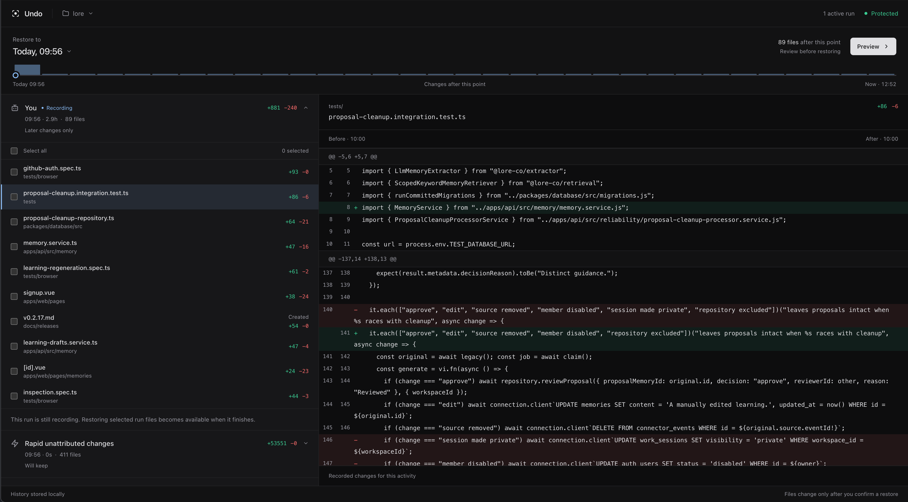

# Undo

## Give your files or agents an undo button

Undo records changes across your project, so you can see what happened and
restore earlier versions when something goes wrong. It works with coding agents,
scripts, tools, and your own edits.

## Install

```bash
curl -fsSL https://useundo.co/install.sh | bash
```

Available for macOS (Apple Silicon and Intel) and Linux (x86_64, glibc 2.36+).

If an older recorder is still running during an upgrade, follow the
[legacy recorder guidance](docs/storage.md#upgrading-with-a-legacy-recorder).

## Set up automatic recording

```bash
undo setup --agent claude
```

Start a new Claude session normally. Undo's installed lifecycle hooks start the
recorder automatically and attribute reported file changes to that session—no
`undo run claude` wrapper required.

Cursor and Codex are supported too:

```bash
undo setup --agent cursor
undo setup --agent codex
```

Each setup command safely merges Undo's hooks into the agent's existing user
configuration. Running it again updates the Undo hooks without replacing other
settings. Hooks retain session attribution when the agent supplies a blank
conversation ID and a valid session ID. See the [hook behavior](docs/cli.md#install-agent-hooks).

## Restore from the local UI

```bash
undo ui
```



The restore-first interface lets you:

- preview a 10-minute rewind or choose an exact restore time
- review concurrent agent Runs and unattributed edits in one timeline
- select exactly which files to restore
- inspect per-file diffs before anything changes

When two agents claim the same recorded change, Undo marks it as a collision and
blocks unsafe agent-specific recovery. Exclusive reported changes remain
selectively recoverable. Every restore uses a preview-then-apply plan and backs
up the current files first. Run recovery rejects selected paths without recorded
changes in that Run. Window Runs use recorded event order for membership, so
system clock changes cannot hide their recorded changes from Run recovery.
Selected-file recovery accepts `--path ./src/auth.rs` as well as
`--path src/auth.rs`, including when the file has been deleted.

To compare the experimental syntax-highlighted Pierre diff renderer, append
`&diff=pierre` to the tokenized URL printed by `undo ui`. The lightweight Undo
renderer remains the default.

## CLI workflows

The wrapper workflow remains available for unsupported agents and commands:

```bash
undo run claude
undo run exec --agent "My Agent" -- my-agent --non-interactive
undo runs
undo run show r_421
undo ask r_421 "remove the auth migration work"
undo apply rec_812
```

`undo ask` creates a preview and changes nothing. `undo apply` applies the exact
preview you reviewed. Ask prefers a uniquely matching completed task: for
example, "undo the fixes" can select a task named "fix". See the
[recovery selection rules](docs/recovery.md#1-prefer-one-matching-intent).

To recover a whole file group, use its ID from `undo run show` with
`undo recover --run r_421 --group <ID> --preview`. Scripts can read the same
IDs from `change_groups` in `undo run show r_421 --json`.

The legacy `undo session stop` command also synchronizes files before completing
a Run, so pending edits remain available to Run recovery. See
[session compatibility commands](docs/cli.md#use-older-session-commands).

Undo can also restore recorded files by time, recover deleted files, and help
after a large unexpected change:

```bash
undo timeline --since 10m
undo timeline --deleted --since 1h --limit 20
undo what-changed 10m
undo diff src/server.rs 10m
undo preview src/server.rs 10m
undo restore src/server.rs 10m
undo restore-deleted src/old-api.rs
undo panic
```

When a single-file time target falls during a deleted period, restore uses the last
contents before that deletion, even if the path was later recreated.

Everything stays under `~/.undo/`. There is no account or cloud service.
Closely spaced writes get a final reread after 500 ms of quiet so the recorder
can capture their completed contents.

## Learn more

- [Getting started](docs/getting-started.md)
- [Documentation](docs/README.md)
- [Recovery behavior and safety](docs/recovery.md)
- [CLI reference](docs/cli.md)
- [Contributing](CONTRIBUTING.md)
- [Security](SECURITY.md)

## License

[FSL-1.1-MIT](LICENSE)
